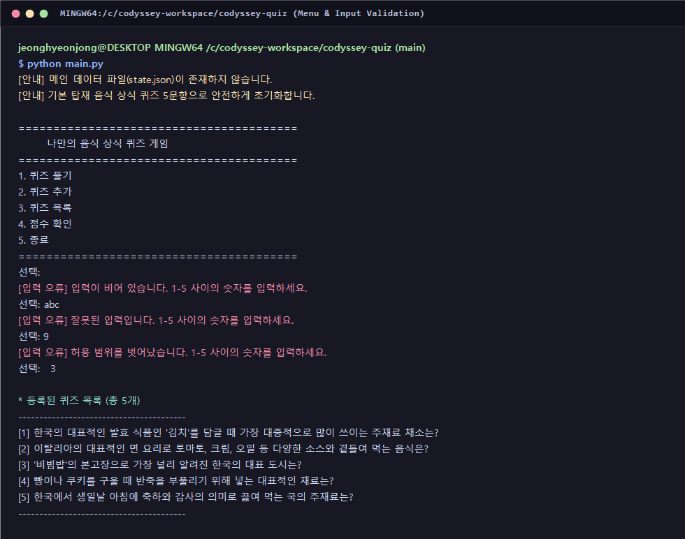
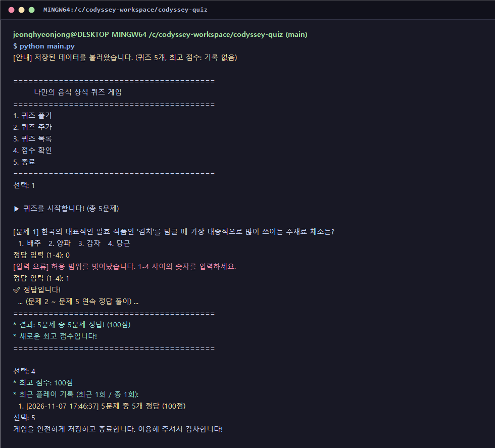
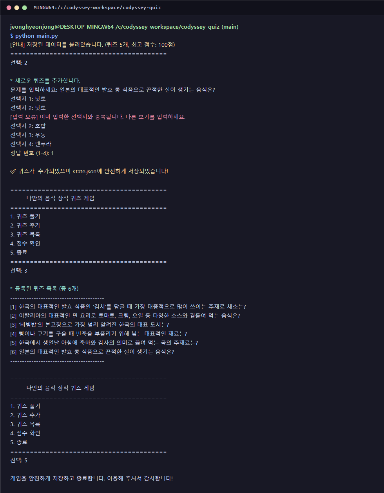
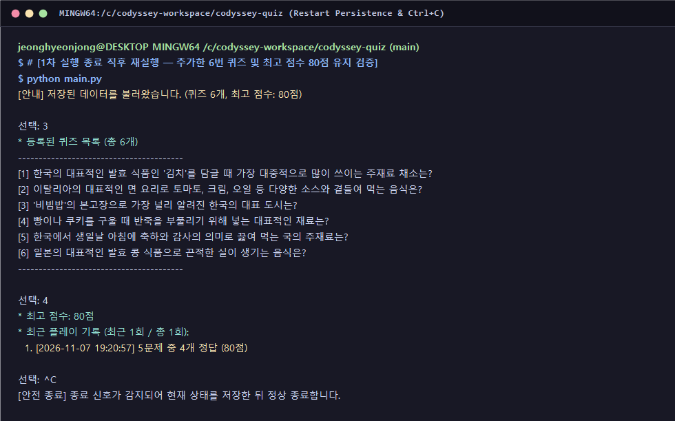
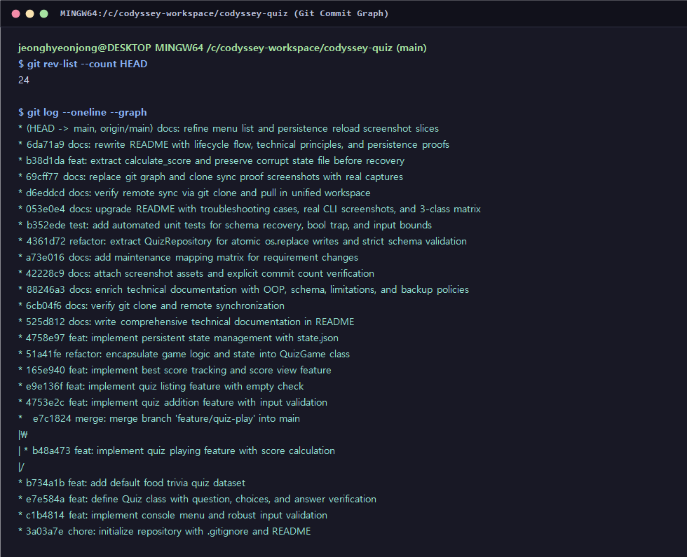
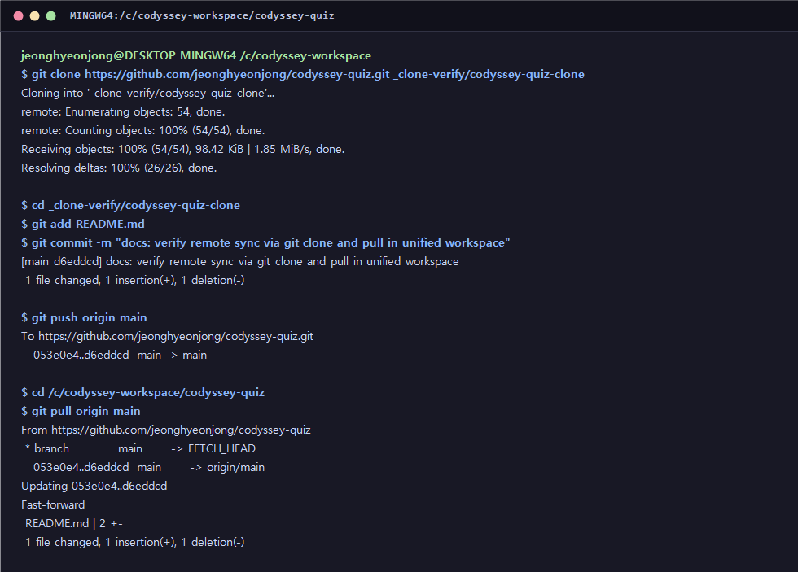

# 나만의 음식 상식 퀴즈 게임 (Codyssey OOP Quiz Game)

## 1. 프로젝트 개요 및 기본 데이터 구성

터미널(CLI) 환경에서 동작하는 **단일 책임 원칙(SRP) 기반 객체지향 파이썬 4지선다 퀴즈 게임 애플리케이션**입니다.
사용자는 기본 탑재된 음식 상식 5문항을 풀고 정오답 피드백과 점수를 확인하며, 대화형 검증을 거쳐 새로운 퀴즈를 직접 추가하거나 전체 문제 목록과 최고 점수(최근 풀이 기록 포함)를 조회할 수 있습니다.
프로그램을 정상 종료한 뒤 재실행하는 경우는 물론, 실행 도중 예기치 않은 인터럽트(`Ctrl+C`, `EOFError`)나 파일 손상이 발생하더라도 추가한 퀴즈와 최고 점수를 잃지 않도록 **원자적 파일 교체(`os.replace`)**와 **3단계 무결성 복구 아키텍처**를 적용했습니다.

- **원격 저장소 URL**: https://github.com/jeonghyeonjong/codyssey-quiz.git
- **저장소 공개 여부**: Public Repository
- **개발 및 실행 환경**:
  - OS / Shell: Windows 11 / Git Bash
  - Language: Python 3.15.2 (Python 3.10 이상 공식 요구조건 충족, 외부 라이브러리 없이 순수 표준 라이브러리만 사용)
  - Version Control: Git / GitHub (`init`, `add`, `commit`, `push`, `pull`, `checkout`, `clone` 및 `--no-ff` 기능 브랜치 병합 적용)

### 기본 탑재 5문항 구성 및 주제 선정 배경
초기 구동 시 별도 데이터 입력 없이도 전 기능을 즉시 검증할 수 있도록 한국·세계 음식 상식 **기본 퀴즈 5문항**(김치 주재료, 이탈리아 파스타, 전주 비빔밥, 제빵 베이킹파우더, 생일 미역국)을 기본 데이터셋(`QuizRepository.create_default_quizzes()`)으로 내장했습니다.
전공 지식과 무관하게 누구나 직관적으로 풀 수 있고 정답 기준이 명확하여, 정답·오답 판정과 점수 계산(`100점` 만점 환산), 최고 점수 갱신 흐름을 객관적으로 검증하기에 적합합니다.

---

## 2. 디렉터리 구조 (Tree) 및 실행 방법

### 1) 디렉터리 구조와 파일별 역할

    codyssey-quiz/
    ├── .gitignore                 # Python 캐시(__pycache__/), 임시 파일(*.tmp), 손상 보관본(*.corrupt) 제외
    ├── main.py                    # 메인 애플리케이션 (Quiz, QuizRepository, QuizGame 3개 독립 클래스)
    ├── state.json                 # 퀴즈 목록·최고 점수·풀이 히스토리 UTF-8 영속 저장 파일
    ├── state.json.bak             # 원자적 교체 직전 정상 원본을 보존하는 자동 복구용 백업 파일
    ├── tests/
    │   ├── __init__.py            # 단위 테스트 패키지 초기화
    │   └── test_quiz_game.py      # 도메인 검증, 손상 복구(.corrupt/.bak), 입력 경계값 및 안전 종료 자동화 테스트
    ├── docs/                      # 실제 터미널 실행 및 Git 워크플로우 증빙 이미지
    │   ├── menu_validation.png    # 메인 메뉴 표시, 4대 입력 오류 방어 및 기본 5문항 목록 조회
    │   ├── play_score.png         # 퀴즈 풀기(정답·오답 판정 및 경계값 방어), 점수 계산 및 기록 확인
    │   ├── add_quiz.png           # 신규 퀴즈 추가(빈 입력·중복 보기 방어) 및 저장 종료
    │   ├── persistence_reload.png # 종료 후 재실행 시 추가 퀴즈·최고 점수 유지 확인 및 Ctrl+C 안전 종료
    │   ├── git_commit_count.png   # 기능 단위 커밋 수 및 feature/quiz-play 브랜치 병합 그래프
    │   └── git_clone_pull.png     # git clone 및 git pull 원격 저장소 동기화 실습 기록
    └── README.md                  # 아키텍처 설계, 데이터 흐름, 핵심 원리 및 유지보수 매핑 문서

### 2) 프로그램 및 자동화 테스트 실행 명령어

`QuizRepository`가 `__file__` 기준 절대 경로로 데이터 파일을 고정하므로 어느 작업 디렉터리에서 실행하더라도 동일한 프로젝트 루트의 `state.json`을 일관되게 참조합니다.

    $ cd /c/codyssey-workspace/codyssey-quiz
    $ python main.py

    # 스키마 무결성, 3단계 복구, 입력 경계값 및 점수 계산 단위 테스트 실행
    $ python tests/test_quiz_game.py -v

---

## 3. 객체지향(OOP) 클래스 설계 및 관심사 분리 구조

### 1) 3대 클래스 책임 분할 명세 (`Quiz` · `QuizRepository` · `QuizGame`)

단일 파일 안에 모든 역할을 몰아넣는 거대 클래스(God Class)를 지양하고, 변경 이유가 서로 다른 세 영역을 **`Quiz`(도메인 모델)**, **`QuizRepository`(영속성 저장소)**, **`QuizGame`(콘솔 제어 및 게임 흐름)**의 3개 클래스로 분리했습니다.

| 클래스 | 핵심 속성 및 메서드 | 담당 책임 (Single Responsibility) |
| :--- | :--- | :--- |
| **`Quiz`** | `REQUIRED_CHOICE_COUNT`, `question`, `choices`, `answer`, `hint` | 단일 퀴즈 문항의 데이터 구조 표현 및 생성 시점 도메인 불변식 보장 |
| **`Quiz`** | `_validate_question`, `_validate_choices`, `_validate_answer` | 빈 지문, 보기 개수 불일치, 중복 보기, `bool` 서브클래스 함정(`True == 1`), 범위 밖 정답 차단 |
| **`Quiz`** | `display(number)`, `is_correct(user_answer)`, `to_dict()`, `from_dict(data)` | 문제 서식 출력, 사용자 답안 정오답 판정, JSON 직렬화·역직렬화 변환 |
| **`QuizRepository`** | `state_file`, `backup_file`, `temp_file`, `corrupt_file` | 실행 위치 독립 경로 관리 및 메인·백업·임시·손상보관 파일 수명주기 관리 |
| **`QuizRepository`** | `_parse_and_validate_file`, `load_state`, `save_state`, `create_default_quizzes` | UTF-8 JSON 읽기·쓰기, 스키마 검증, 원자적 교체(`os.replace`), 3단계 백업·복구 전담 |
| **`QuizGame`** | `_prompt_int_in_range`, `get_menu_choice`, `get_quiz_answer` | 사용자 콘솔 입력 수신, 앞뒤 공백 정규화(`.strip()`) 및 범위·타입 오류 재입력 유도 |
| **`QuizGame`** | `play_quiz`, `calculate_score`, `add_quiz`, `list_quizzes`, `view_score`, `run` | 메뉴 라우팅, 퀴즈 출제·채점·최고 점수 갱신, 신규 문제 등록 및 인터럽트 안전 종료 제어 |

### 2) 관심사 분리 기준: 입력 처리(검증) · 게임 진행 · 데이터 저장/불러오기

세 가지 핵심 로직이 서로 강하게 결합되지 않도록 **"외부 문자열을 정제하는가, 메모리 객체로 규칙을 수행하는가, 디스크 파일과 통신하는가"**를 기준으로 경계를 나눴습니다.

1. **입력 처리 및 검증 계층 (UI 경계 방어 + 도메인 불변식 방어)**:
   - **1차 콘솔 입력 정제 (`QuizGame._prompt_int_in_range`, `add_quiz`)**: `input()`으로 들어오는 원시 문자열의 앞뒤 공백을 `.strip()`으로 먼저 제거한 뒤 빈 입력(`""`), 비숫자(`"abc"`), 허용 범위 이탈(`0`, `9`), 중복 선택지를 걸러내어 **검증된 정수·문자열만 다음 단계로 전달**합니다.
   - **2차 도메인 스키마 검증 (`Quiz._validate_*`)**: 콘솔 입력뿐 아니라 외부에서 직접 수정된 `state.json`을 역직렬화할 때도 동일한 무결성 규칙이 강제되도록 `Quiz` 생성자 내부에 최종 검증을 배치했습니다.
2. **게임 진행 계층 (순수 비즈니스 흐름 제어)**:
   - `QuizGame.play_quiz()`, `calculate_score()`, `list_quizzes()`, `view_score()`는 파일 경로가 무엇인지나 원시 문자열 파싱이 어떻게 이루어지는지 알 필요 없이, 메모리에 적재된 `Quiz` 인스턴스 리스트와 정제된 답안 번호만으로 출제 순회, 정오답 집계, 100점 환산 점수 계산, 최고 점수 갱신을 수행합니다.
3. **데이터 저장/불러오기 계층 (영속성 격리)**:
   - `QuizRepository` 내부에는 `input()` 호출이나 게임 진행 조건문이 전혀 존재하지 않습니다. 오직 `list[Quiz]`와 점수·기록 데이터를 받아 디스크에 원자적으로 기록(`save_state`)하거나 검증 후 복원(`load_state`)하는 역할만 수행하므로, 향후 저장 매체를 데이터베이스로 바꾸더라도 게임 진행 및 입력 코드는 수정할 필요가 없습니다.

### 3) 클래스를 사용한 이유와 함수 중심 구현 대비 차이점

함수와 기본 자료형(`dict`, `list`)만으로 구현할 경우 `play_quiz(quizzes, best_score, history)`처럼 모든 함수 호출마다 상태 변수들을 인자와 반환 튜플로 계속 전달하거나 `global best_score` 같은 전역 변수를 직접 변경해야 합니다. 이 방식은 코드 규모가 조금만 커져도 어느 함수가 상태를 바꿨는지 추적하기 어렵고, 개별 퀴즈가 단순 딕셔너리(`{"question": ...}`)로 떠돌아다녀 필수 키 누락이나 잘못된 정답 번호가 런타임 중간에 뒤늦게 오류를 일으킵니다.

반면 클래스를 사용해 상태와 행위를 캡슐화하면 다음과 같은 구조적 이점을 얻습니다.
- **도메인 무결성 보장**: `Quiz` 인스턴스가 생성되는 순간 지문·보기·정답 검증이 완료되므로, 게임 루프 안에서는 항상 유효성이 보장된 객체만 다루며 `quiz.is_correct(ans)`처럼 데이터와 판정 로직이 응집됩니다.
- **전역 변수 없는 상태 일관성**: `QuizGame` 인스턴스가 `self.quizzes`, `self.best_score`, `self.history`를 내부 속성으로 보유하여 `global` 키워드 없이도 메뉴 기능 간 상태를 안전하게 공유합니다.
- **테스트 격리성 확보**: 단위 테스트(`tests/test_quiz_game.py`) 작성 시 `QuizRepository(base_dir=tmpdir)`처럼 임시 디렉터리를 주입한 별도 인스턴스를 생성할 수 있어, 실제 운영 중인 `state.json`을 전혀 오염시키지 않고 손상 복구 시나리오를 반복 검증할 수 있습니다.

---

## 4. JSON 데이터 스키마 설계 및 상태 읽기·쓰기 생명주기

### 1) JSON 저장 방식을 채택한 이유와 JSON 형식의 특징

별도의 외부 DB 서버 설치 없이 파이썬 표준 라이브러리(`json`)만으로 어디서나 즉시 재현할 수 있도록 영속성 포맷으로 **UTF-8 JSON(JavaScript Object Notation)**을 선택했습니다.

- **가독성과 범용성**: 사람이 일반 텍스트 편집기로 직접 열어 저장된 문항과 점수를 눈으로 확인·디버깅할 수 있는 텍스트 기반 표준 포맷이며, 특정 언어에 종속되지 않아 추후 웹 프론트엔드나 REST API로 데이터를 이관할 때 그대로 호환됩니다.
- **타 파일 형식 대비 안전성 및 표현력**: 파이썬 전용 이진 포맷인 `pickle`은 손상·변조된 파일 로드 시 임의 코드 실행 보안 취약점이 있고 버전 간 호환이 어렵습니다. 반대로 단순 `.txt`나 `.csv` 파일은 지문 안에 쉼표(`,`)가 포함되거나 선택지 배열(`choices`)·플레이 로그(`history`)처럼 **1:N 계층 구조**를 표현할 때 구분자 파싱이 쉽게 깨집니다.
- **JSON 형식의 구조적 특징**: 이름-값 쌍으로 이루어진 **객체(`{}` ↔ Python `dict`)**와 순서가 유지되는 **배열(`[]` ↔ Python `list`)**을 중첩해 복합 자료구조를 직관적으로 표현하며, 문자열(`string`), 숫자(`number`), 불리언(`true`/`false`), 빈 값(`null` ↔ Python `None`)의 명확한 원시 타입을 지원합니다. 본 프로젝트에서는 `ensure_ascii=False, indent=2` 옵션을 적용해 한글 지문이 유니코드 이스케이프(`\uXXXX`) 없이 원문 그대로 깔끔하게 저장되도록 구성했습니다.

### 2) `state.json` 필드 및 중첩 구조 설계 근거

    {
      "quizzes": [
        {
          "question": "한국의 대표적인 발효 식품인 '김치'를 담글 때 가장 대중적으로 많이 쓰이는 주재료 채소는?",
          "choices": [
            "배추",
            "양파",
            "감자",
            "당근"
          ],
          "answer": 1,
          "hint": "배추김치의 주재료입니다."
        }
      ],
      "best_score": 80,
      "history": [
        {
          "played_at": "2026-11-07 19:15:00",
          "total": 5,
          "correct": 4,
          "score": 80
        }
      ]
    }

1. **루트를 배열(`[]`)이 아닌 객체(`{}`)로 설계한 이유**: 최상위 구조를 문제 리스트로 고정하면 최고 점수(`best_score`)나 풀이 이력(`history`), 향후 사용자 설정 필드를 함께 담을 수 없습니다. 루트를 딕셔너리 객체로 감싸 도메인 데이터(`quizzes`)와 집계 메타데이터(`best_score`, `history`)를 명확히 분리하고 하위 호환 확장성을 확보했습니다.
2. **선택지를 개별 키(`choice1~4`) 대신 중첩 배열(`"choices": [...]`)로 둔 이유**: 순서가 보장되는 배열을 사용하면 `1~4`번 출력 순서를 그대로 유지하면서도 `enumerate(self.choices, 1)`로 간결하게 순회할 수 있고, 향후 5지선다 등으로 문항 구조가 바뀌더라도 스키마 필드 이름을 고치지 않고 배열 길이만 검증(`len(choices) == REQUIRED_CHOICE_COUNT`)하면 됩니다.
3. **초기 최고 점수를 `0`이 아닌 `null`(`None`)로 표현한 이유**: 아직 한 번도 퀴즈를 풀지 않은 초기 상태(`null` → `"아직 퀴즈를 푼 기록이 없습니다"`)와 실제로 퀴즈를 풀어 0점을 기록한 상태(`0` → `"최고 점수: 0점"`)를 명확히 구분하기 위함입니다.

### 3) 프로그램 내 `state.json` 읽기·쓰기 발생 위치와 실행 순서

불필요한 디스크 I/O를 줄이면서도 상태 변경 즉시 영속성을 확보하기 위해 **읽기는 구동 시 1회, 쓰기는 상태 확정 및 종료 시점 4곳**에서 명확한 순서로 수행됩니다.

    [구동 시 읽기 흐름 — 총 1회]
    main() ──> QuizGame.__init__() ──> QuizRepository.load_state()
       ├─ (1) state.json 존재 시 _parse_and_validate_file()로 JSON 문법 및 스키마 검증
       ├─ (2) 검증 통과 시 메모리의 self.quizzes, self.best_score, self.history 에 적재 후 메뉴 진입
       └─ (3) 부재·손상 시 state.json.corrupt 보존 ──> state.json.bak 검증 복원 ──> 기본 5문항 초기화 후 즉시 save_state()

    [실행 중 쓰기 흐름 — 상태 확정 및 종료 4대 시점]
    ① 1. 퀴즈 풀기 완료 직후 (QuizGame.play_quiz 말미)
       전 문항 채점 완료 ──> calculate_score() 점수 산출 ──> best_score 갱신 비교 ──> history 추가 ──> save_state()
    ② 2. 퀴즈 추가 완료 직후 (QuizGame.add_quiz 말미)
       지문·4개 보기·정답 번호 검증 통과 ──> Quiz 인스턴스 생성 및 self.quizzes.append() ──> save_state()
    ③ 5. 종료 선택 시 (QuizGame.run 루프 탈출 직전)
       현재 메모리 상태를 최종 save_state() ──> 안내 메시지 출력 후 함수 정상 반환
    ④ Ctrl+C / EOF 감지 시 (QuizGame.run 예외 처리 블록)
       진행 중이던 미완성 입력은 폐기하고 검증 완료된 메모리 상태만 save_state() ──> 안전 종료

단순 조회 메뉴인 `3. 퀴즈 목록`과 `4. 점수 확인`은 디스크를 다시 읽지 않고 메모리의 `self.quizzes`와 `self.best_score`를 즉시 출력합니다. 반대로 `save_state()`가 호출될 때는 언제나 **① `state.json.tmp` 직렬화 및 `flush()` + `os.fsync()` 디스크 동기화 → ② 기존 정상 `state.json`을 `state.json.bak`으로 복사 → ③ `os.replace(temp_file, state_file)` 원자적 교체** 순서로 기록됩니다.

---

## 5. 파일 입출력 예외 방어 및 안전 종료(Graceful Shutdown) 설계

### 1) 파일 입출력에서 `try/except`가 필수적인 이유와 실패 케이스

메모리 내부 변수 연산과 달리 파일 입출력은 **운영체제 파일 시스템, 디스크 잔여 공간, 외부 프로세스의 개입**이라는 통제 불가능한 외부 환경에 의존합니다. 따라서 파일이 항상 존재하고 정상 형식일 것이라고 가정한 채 `try/except` 없이 `open()`이나 `json.load()`를 호출하면, 사소한 외부 요인만으로도 프로그램이 곧바로 비정상 종료(Crash)됩니다.

`QuizRepository._parse_and_validate_file()`과 `save_state()`에서는 다음 **5가지 구체적 실패 케이스**를 예외 처리로 포착하여 무중단 복구 흐름으로 연결합니다.
1. **파일 부재 (`FileNotFoundError` / `OSError`)**: 최초 실행 시 아직 `state.json`이 생성되지 않았거나 실행 중 외부에서 파일이 삭제된 경우.
2. **권한 거부 및 디스크 오류 (`PermissionError` / `OSError`)**: 다른 편집기·백신 프로세스가 파일을 잠그고 있거나 쓰기 권한 부족, 디스크 용량 고갈로 `.tmp` 기록이나 교체가 실패하는 경우.
3. **문자 인코딩 손상 (`UnicodeDecodeError`, `ValueError` 하위)**: 사용자가 Windows 메모장 등에서 UTF-8이 아닌 ANSI(CP949) 인코딩으로 파일을 다시 저장해 바이트 디코딩이 실패하는 경우.
4. **JSON 문법 파손 (`json.JSONDecodeError`)**: 정전·강제 종료로 파일이 빈 파일(0바이트)이 되었거나 수동 편집 중 쉼표·따옴표·중괄호 짝이 깨진 경우.
5. **논리 스키마 불일치 (`KeyError`, `TypeError`, `ValueError`)**: JSON 문법 자체는 유효하지만 필수 필드(`question`, `choices`, `answer`)가 빠졌거나 보기 개수가 4개가 아닌 경우, 혹은 `answer: 99`, `best_score: -10`처럼 도메인 허용 범위를 벗어난 값이 주입된 경우.

### 2) `Ctrl+C` 및 `EOF` 발생 시 안전 종료 처리 메커니즘

사용자가 메뉴 선택이나 퀴즈 풀이, 문제 추가 입력 도중 언제든지 `Ctrl+C`(`KeyboardInterrupt`)를 누르거나 입력 스트림이 종료(`Ctrl+D` / Windows `Ctrl+Z` → `EOFError`)될 수 있습니다. 별도 처리를 하지 않으면 파이썬 인터프리터가 긴 스택 트레이스(Traceback)를 출력하며 즉시 멈추고, 직전 상태가 보장되지 않아 사용자 경험을 해칩니다.

이를 방지하기 위해 2중 안전 종료 구조를 적용했습니다.
- **루프 내부 상태 보존 종료 (`QuizGame.run`)**: `while True` 루프 전체를 `try / except (KeyboardInterrupt, EOFError)`로 감싸, 입력 대기 중 신호가 감지되면 즉시 포착합니다. 이때 `add_quiz()` 입력 도중이었다면 아직 검증이 끝나지 않은 지역 변수(`question`, `choices`)는 `self.quizzes`에 추가되지 않은 상태이므로 반쪽짜리 문제가 섞이지 않으며, 이미 검증 완료된 메모리 상태(`self.quizzes`, `self.best_score`, `self.history`)만 원자적으로 `self.save_state()`한 뒤 안내 메시지를 출력하고 정상 종료(`return`)합니다.
- **엔트리포인트 방어 (`main`)**: `QuizGame()` 초기화 과정 등에서 인터럽트가 발생하더라도 최외곽 `main()`의 `except (KeyboardInterrupt, EOFError)` 블록이 한 번 더 감싸 비정상 종료 코드 없이 깔끔하게 종료됩니다.

---

## 6. 기능별 실제 실행 로그 및 재실행 영속성 증빙

### 1) 메인 메뉴 출력, 4대 입력 오류 방어(빈 입력·문자·범위 밖·앞뒤 공백) 및 기본 5문항 조회

빈 엔터(`""`), 문자열(`"abc"`), 범위 밖 번호(`"9"`) 입력 시 오류 원인을 안내하고 재입력을 받으며, 앞뒤 공백이 섞인 `"  3  "` 입력은 `.strip()` 정규화를 통해 정상적으로 기본 5문항 목록을 출력합니다.

    $ python main.py
    [안내] 메인 데이터 파일(state.json)이 존재하지 않습니다.
    [안내] 기본 탑재 음식 상식 퀴즈 5문항으로 안전하게 초기화합니다.

    ========================================
            나만의 음식 상식 퀴즈 게임
    ========================================
    1. 퀴즈 풀기
    2. 퀴즈 추가
    3. 퀴즈 목록
    4. 점수 확인
    5. 종료
    ========================================
    선택: 
    [입력 오류] 입력이 비어 있습니다. 1-5 사이의 숫자를 입력하세요.
    선택: abc
    [입력 오류] 잘못된 입력입니다. 1-5 사이의 숫자를 입력하세요.
    선택: 9
    [입력 오류] 허용 범위를 벗어났습니다. 1-5 사이의 숫자를 입력하세요.
    선택:   3  

    📋 등록된 퀴즈 목록 (총 5개)
    ----------------------------------------
    [1] 한국의 대표적인 발효 식품인 '김치'를 담글 때 가장 대중적으로 많이 쓰이는 주재료 채소는?
    [2] 이탈리아의 대표적인 면 요리로 토마토, 크림, 오일 등 다양한 소스와 곁들여 먹는 음식은?
    [3] '비빔밥'의 본고장으로 가장 널리 알려진 한국의 대표 도시는?
    [4] 빵이나 쿠키를 구울 때 반죽을 부풀리기 위해 넣는 대표적인 재료는?
    [5] 한국에서 생일날 아침에 축하와 감사의 의미로 끓여 먹는 국의 주재료는?
    ----------------------------------------

### 2) 퀴즈 풀기(정답·오답 판정 및 경계값 방어), 점수 산출 및 기록 확인

경계값 `0` 입력 차단과 공백 포함 답안(`"  1  "`) 정답 판정, 오답 입력(`4`) 시 실제 정답 번호·보기 안내(`정답: 2번 - 파스타`), 5문제 중 4문제 정답에 따른 `80점` 산출 및 최고 점수 조회 결과입니다.

    선택: 1

    ▶ 퀴즈를 시작합니다! (총 5문제)

    [문제 1] 한국의 대표적인 발효 식품인 '김치'를 담글 때 가장 대중적으로 많이 쓰이는 주재료 채소는?
      1. 배추
      2. 양파
      3. 감자
      4. 당근
    정답 입력 (1-4): 0
    [입력 오류] 허용 범위를 벗어났습니다. 1-4 사이의 숫자를 입력하세요.
    정답 입력 (1-4):   1  
    ✅ 정답입니다!

    [문제 2] 이탈리아의 대표적인 면 요리로 토마토, 크림, 오일 등 다양한 소스와 곁들여 먹는 음식은?
      1. 타코
      2. 파스타
      3. 쌀국수
      4. 메밀소바
    정답 입력 (1-4): 4
    ❌ 오답입니다! (정답: 2번 - 파스타)

      ... (문제 3 ~ 문제 5 정답 입력 진행) ...
    ========================================
    🏆 결과: 5문제 중 4문제 정답! (80점)
    🎉 새로운 최고 점수입니다!
    ========================================

    선택: 4
    🏆 최고 점수: 80점
    📊 최근 플레이 기록 (최근 1회 / 총 1회):
      1. [2026-11-07 19:15:00] 5문제 중 4개 정답 (80점)

### 3) 신규 퀴즈 추가(빈 지문·중복 보기 방어) 및 정상 저장 종료

새 문제를 등록할 때 빈 지문 입력과 중복된 선택지(`낫토` 2회 입력)를 차단하고, 6번째 문제를 `state.json`에 즉시 저장한 뒤 `5. 종료`로 프로세스를 마치는 화면입니다.

    선택: 2

    📌 새로운 퀴즈를 추가합니다.
    문제를 입력하세요: 
    [입력 오류] 문제는 비워둘 수 없습니다. 다시 입력해 주세요.
    문제를 입력하세요: 일본의 대표적인 발효 콩 식품으로 끈적한 실이 생기는 음식은?
    선택지 1: 낫토
    선택지 2: 낫토
    [입력 오류] 이미 입력한 선택지와 중복됩니다. 다른 보기를 입력하세요.
    선택지 2: 초밥
    선택지 3: 우동
    선택지 4: 덴푸라
    정답 번호 (1-4): 1

    ✅ 퀴즈가 추가되었으며 state.json에 안전하게 저장되었습니다!

    선택: 5
    게임을 안전하게 저장하고 종료합니다. 이용해 주셔서 감사합니다!

### 4) 프로그램 종료 후 재실행 시 추가 퀴즈·최고 점수 유지 확인 및 `Ctrl+C` 안전 종료

위 1차 실행을 완전히 종료한 뒤 새로운 프로세스로 `python main.py`를 다시 실행했을 때, 직전 세션에서 추가한 6번째 퀴즈(`낫토` 문항)와 최고 점수(`80점`)가 그대로 복원되어 유지되는 모습과 `Ctrl+C` 인터럽트 감지 시 안전 종료되는 실제 로그입니다.

    $ # [1차 실행 종료 직후 재실행 — 추가한 6번 퀴즈 및 최고 점수 80점 유지 검증]
    $ python main.py
    [안내] 저장된 데이터를 불러왔습니다. (퀴즈 6개, 최고 점수: 80점)

    선택: 3
    📋 등록된 퀴즈 목록 (총 6개)
    ----------------------------------------
    [1] 한국의 대표적인 발효 식품인 '김치'를 담글 때 가장 대중적으로 많이 쓰이는 주재료 채소는?
    [2] 이탈리아의 대표적인 면 요리로 토마토, 크림, 오일 등 다양한 소스와 곁들여 먹는 음식은?
    [3] '비빔밥'의 본고장으로 가장 널리 알려진 한국의 대표 도시는?
    [4] 빵이나 쿠키를 구울 때 반죽을 부풀리기 위해 넣는 대표적인 재료는?
    [5] 한국에서 생일날 아침에 축하와 감사의 의미로 끓여 먹는 국의 주재료는?
    [6] 일본의 대표적인 발효 콩 식품으로 끈적한 실이 생기는 음식은?
    ----------------------------------------

    선택: 4
    🏆 최고 점수: 80점
    📊 최근 플레이 기록 (최근 1회 / 총 1회):
      1. [2026-11-07 19:15:00] 5문제 중 4개 정답 (80점)

    선택: ^C
    [안전 종료] 종료 신호가 감지되어 현재 상태를 저장한 뒤 정상 종료합니다.

---

## 7. Git 커밋 전략, 브랜치 병합 및 원격 동기화 증빙

### 1) 커밋 분할 단위 기준 및 Conventional Commits 메시지 규칙

전체 코드를 한 번에 몰아서 올리지 않고, **"단독으로 실행·검증 및 롤백 가능한 하나의 논리적 작업 단위"**를 기준으로 커밋을 세분화했습니다.
저장소 초기화 → 메뉴 및 입력 검증기 → `Quiz` 도메인 모델 → 기본 5문항 데이터 → 퀴즈 풀이 기능 브랜치 구현 및 병합 → 문제 추가·목록·점수 기능 → `QuizGame` 캡슐화 리팩터링 → `state.json` 영속화 및 `QuizRepository` 원자적 백업 분리 → 자동화 단위 테스트 → 기술 문서화의 순서로 이력을 구성했습니다.

커밋 메시지는 변경 성격을 첫 단어만으로 식별할 수 있도록 **Conventional Commits** 접두어 규칙을 일관되게 적용했습니다.
- `chore:` 저장소 초기화, `.gitignore` 등 환경 설정
- `feat:` 사용자 기능, 점수 계산기, 손상 원본 보존 등 신규 기능 추가
- `refactor:` 외부 동작 변경 없이 클래스 분리(`QuizGame`, `QuizRepository`) 등 내부 설계 개선
- `test:` `unittest` 기반 자동화 검증 코드 추가 및 보강
- `docs:` `README.md` 아키텍처 문서화 및 실행 증빙 이미지 갱신
- `merge:` 독립 기능 브랜치 작업본을 `main` 브랜치로 통합

### 2) 기능 브랜치(`feature/quiz-play`) 분리 이유와 병합(`merge`)의 의미

- **브랜치를 분리해 작업한 이유**: 출제 반복문, 사용자 답안 입력 검증, 정오답 판정, 점수 환산이 한꺼번에 맞물리는 핵심 기능(`play_quiz`)을 개발할 때, 작성 중인 불완전한 코드가 언제든 실행 가능해야 하는 주류(`main`) 브랜치의 안정성을 해치지 않도록 독립된 작업 공간을 격리하기 위함입니다.
- **병합(`merge`)의 의미**: 격리된 브랜치에서 기능 구현과 단독 테스트를 모두 마친 검증된 변경 이력을 다시 `main` 브랜치에 합류시키는 통합 절차입니다. 이때 기본 Fast-Forward 방식 대신 `git merge --no-ff feature/quiz-play` 옵션을 사용하여 브랜치 분기선이 직선으로 지워지지 않도록 명시적 병합 커밋(`e7c1824`)을 남겼으며, 이를 통해 그래프 상에서 기능 단위의 분기 시점과 통합 지점을 명확히 추적할 수 있습니다.

### 3) 커밋 그래프(`git log --oneline --graph`) 및 `clone` / `pull` 실습 증빙

    $ git rev-list --count HEAD
    24

    $ git log --oneline --graph
    * (HEAD -> main, origin/main) docs: refine menu list and persistence reload screenshot slices
    * 6da71a9 docs: rewrite README with lifecycle flow, technical principles, and persistence proofs
    * b38d1da feat: extract calculate_score and preserve corrupt state file before recovery
    * 69cff77 docs: replace git graph and clone sync proof screenshots with real captures
    * d6eddcd docs: verify remote sync via git clone and pull in unified workspace
    * 053e0e4 docs: upgrade README with troubleshooting cases, real CLI screenshots, and 3-class matrix
    * b352ede test: add automated unit tests for schema recovery, bool trap, and input bounds
    * 4361d72 refactor: extract QuizRepository for atomic os.replace writes and strict schema validation
    * a73e016 docs: add maintenance mapping matrix for requirement changes
    * 42228c9 docs: attach screenshot assets and explicit commit count verification
    * 88246a3 docs: enrich technical documentation with OOP, schema, limitations, and backup policies
    * 6cb04f6 docs: verify git clone and remote synchronization
    * 525d812 docs: write comprehensive technical documentation in README
    * 4758e97 feat: implement persistent state management with state.json
    * 51a41fe refactor: encapsulate game logic and state into QuizGame class
    * 165e940 feat: implement best score tracking and score view feature
    * e9e136f feat: implement quiz listing feature with empty check
    * 4753e2c feat: implement quiz addition feature with input validation
    *   e7c1824 merge: merge branch 'feature/quiz-play' into main
    |\  
    | * b48a473 feat: implement quiz playing feature with score calculation
    |/  
    * b734a1b feat: add default food trivia quiz dataset
    * e7e584a feat: define Quiz class with question, choices, and answer verification
    * c1b4814 feat: implement console menu and robust input validation
    * 3a03a7e chore: initialize repository with .gitignore and README

원격 저장소 양방향 동기화 검증을 위해 별도 검증 디렉터리(`/c/codyssey-workspace/_clone-verify/codyssey-quiz`)로 `git clone`을 수행해 독립 실행을 확인한 뒤, 원본 저장소에서 푸시한 커밋을 클론 폴더에서 `git pull origin main`으로 내려받아 로컬-원격-복제본 간 해시 일치를 검증했습니다.

---

## 8. 대규모 확장 시 한계점 및 손상 파일 백업·복구 아키텍처

### 1) 퀴즈 데이터가 1,000개 이상으로 증가할 때 현행 JSON 구조의 한계와 대안

현재의 단일 `state.json` 저장 구조는 수십~수백 문항 규모의 개인용 CLI 학습 도구에는 간결하고 효율적이지만, 문항 수가 **1,000개 이상(혹은 수만 건의 누적 플레이 기록)**으로 늘어날 경우 다음과 같은 구조적 한계가 발생합니다.

1. **부분 갱신 불가와 `O(N)` 전체 재직렬화 병목**: 최고 점수 숫자 하나만 바뀌거나 퀴즈 1개만 추가되어도 1,000개 이상의 전체 문항과 모든 `history` 배열을 처음부터 다시 직렬화(`json.dump`)하여 디스크에 통째로 기록해야 하므로 데이터 양에 비례해 저장 지연(Latency)과 디스크 쓰기 비용이 증가합니다.
2. **전량 메모리 상주 부담 및 인덱스 부재**: 프로그램 시작 시 모든 문항을 한꺼번에 파싱해 RAM의 `self.quizzes` 리스트에 올려두며, 특정 주제·난이도 검색이나 중복 문제 확인 시 인덱스(Index)가 없어 매번 전체 리스트를 순차 탐색(`O(N)`)해야 합니다.
3. **전체 순회 출제로 인한 사용자 경험(UX) 저하**: 현재 `play_quiz()`처럼 등록된 문제를 전부 출제하면 한 번 실행에 1,000문제를 연속으로 풀어야 하므로, `random.sample()`을 이용한 무작위 N문항 추출이나 카테고리별 출제 단위로 개편이 필요합니다.
4. **동시 쓰기 경합(Race Condition)**: 행 단위 잠금(Lock)과 트랜잭션이 없어 두 개 이상의 터미널에서 동시에 실행 후 저장하면 나중에 저장한 프로세스가 이전 변경 내역을 덮어쓰는 유실(Lost Update)이 발생합니다.
- **해결 대안**: 이미 영속성 계층이 `QuizRepository`로 분리되어 있으므로, 상위 `Quiz`·`QuizGame` 코드는 그대로 둔 채 `QuizRepository` 내부 구현만 파이썬 내장 RDBMS인 **`sqlite3`**(인덱스 조회 + 변경 행 단위 `INSERT`/`UPDATE` 트랜잭션)로 교체하면 위 한계를 근본적으로 해소할 수 있습니다.

### 2) `state.json` 손상·파싱 실패 시 데이터 유실 방지 대응 아키텍처

사용자의 수동 편집 실수나 예기치 않은 시스템 오류로 `state.json`이 손상되었을 때 **프로그램 중단과 사용자 데이터 유실을 동시에 막기 위해 사전 예방 + 사후 3단계 복구 체계**를 구축했습니다.

    [사전 예방: 원자적 저장]
    메모리 상태 직렬화 ──> state.json.tmp 기록 및 os.fsync() ──> 정상 state.json 검증 후 state.json.bak 백업 ──> os.replace() 교체

    [사후 대응: 손상 감지 및 3단계 복구]
    1단계: state.json 검증 로드 시도
       └── (파싱·스키마 실패 시) 깨진 원본을 덮어쓰기 전에 state.json.corrupt 로 별도 격리 보존
    2단계: 직전 정상 스냅샷인 state.json.bak 검증 로드 및 자동 복원
       └── 사용자가 추가했던 퀴즈와 최고 점수를 그대로 되살려 정상 state.json 재구축
    3단계: state.json.bak 마저 유실·손상된 극단적 상황에서만 기본 음식 상식 5문항으로 안전 초기화

- **오염 전파 차단**: `save_state()`는 기존 `state.json`이 `_parse_and_validate_file()`을 통과한 정상 파일일 때만 `.bak`으로 복사합니다. 따라서 이미 깨진 파일이 정상 백업본(`state.json.bak`)까지 덮어쓰는 2차 오염이 원천 차단됩니다.
- **손상 원본 격리 보존(`state.json.corrupt`)**: 자동 복구가 `state.json`을 재작성하기 직전 손상된 파일을 `state.json.corrupt`로 대피시켜 두므로, 사용자가 직접 메모장으로 문제를 여러 개 적어 넣다가 쉼표 하나를 빠뜨린 경우에도 작성 중이던 텍스트를 잃지 않고 수동 확인·복원할 수 있습니다.

---

## 9. 트러블슈팅 및 문제 해결 기록

### 사례 1: `state.json` 외부 변조 시 범위 밖 정답 번호 및 Python `bool` 서브클래스 함정 해결
- **문제 현상**: 테스트 중 `state.json`의 `answer` 필드를 `99` 또는 불리언 `true`로 수정했을 때 `json.load()` 단계에서는 아무 오류가 나지 않다가, 오답 출력 시점(`quiz.choices[quiz.answer - 1]`)에 뒤늦게 `IndexError`로 종료되거나 `true`가 정답 `1번`으로 통과되는 현상을 발견했습니다.
- **원인 가설**: `json.load()`는 문법만 검사할 뿐 도메인 값 범위를 알지 못하며, 특히 Python에서는 `bool` 클래스가 `int`를 상속(`issubclass(bool, int) == True`, `True == 1`)하기 때문에 단순 `isinstance(answer, int)` 조건만으로는 불리언 값을 걸러내지 못할 것이라고 가설을 세웠습니다.
- **검증 확인**: 파이썬 인터프리터와 단위 테스트(`tests/test_quiz_game.py`)에서 `isinstance(True, int)`가 `True`를 반환하여 `Quiz(..., answer=True)`가 예외 없이 생성되는 것을 재현·확인했습니다.
- **해결 조치**: `Quiz._validate_answer()`에 `if isinstance(answer, bool) or not isinstance(answer, int)` 조건과 `1 <= answer <= cls.REQUIRED_CHOICE_COUNT` 범위 검사를 명시하고, `QuizRepository._parse_and_validate_file()`이 전체 문항을 `Quiz.from_dict()`로 즉시 검증하여 단 하나라도 어긋나면 곧바로 `.bak` 복구 단계로 전환하도록 개선했습니다.

### 사례 2: 직접 쓰기(`open("w")`) 도중 강제 종료 시 0바이트 파일 손상 위험 제거
- **문제 현상**: 기존 파일에 `open("state.json", "w")`로 직접 덮어쓰는 구조에서는 직렬화 도중 강제 종료 시 원본 파일이 0바이트로 잘려 기존 문제와 최고 점수가 소실될 위험이 있었습니다.
- **원인 가설**: 쓰기 모드(`"w"`)로 파일을 여는 순간 OS가 기존 파일 내용을 즉시 절삭(Truncate)하므로, `json.dump()`가 끝나기 전에 예외나 프로세스 종료가 개입하면 불완전한 파일만 남게 됩니다.
- **검증 확인**: 직렬화 중간 예외 발생 시뮬레이션을 통해 원본 `state.json`이 빈 파일로 파괴되어 `JSONDecodeError`를 유발함을 확인했습니다.
- **해결 조치**: 임시 파일(`state.json.tmp`)에 먼저 완전한 JSON을 기록하고 `flush()` 및 `os.fsync()`로 디스크 기록을 확정한 뒤, 정상 원본을 `.bak`으로 복사하고 OS 파일 시스템 수준에서 원자적 포인터 교체를 수행하는 `os.replace(self.temp_file, self.state_file)` 방식으로 전면 교체했습니다.

### 사례 3: 실행 작업 디렉터리(CWD) 변경 시 `state.json` 중복 생성 문제 해결
- **문제 현상**: 상위 통합 폴더(`/c/codyssey-workspace`)에서 `python codyssey-quiz/main.py`를 실행하면 프로젝트 폴더 안의 기존 `state.json`을 읽지 못하고 상위 폴더에 새 초기 파일이 생성되는 현상이 나타났습니다.
- **원인 가설**: 상대 경로 `"state.json"`은 소스 파일 위치가 아니라 명령어를 호출한 현재 작업 디렉터리(`os.getcwd()`)를 기준으로 해석되기 때문이라고 판단했습니다.
- **검증 확인**: 서로 다른 경로에서 실행 시 `os.path.abspath("state.json")` 출력값이 호출 위치마다 달라지는 것을 확인했습니다.
- **해결 조치**: `QuizRepository.__init__()`에서 `os.path.dirname(os.path.abspath(__file__))`을 기준으로 프로젝트 루트 절대 경로를 계산하도록 수정하여 어느 위치에서 실행하더라도 동일한 데이터 파일을 참조하도록 고정했습니다.

---

## 10. 요구사항 변경 관리 및 수정 대상 매핑 명세 (Maintenance Matrix)

향후 채점 정책이나 퀴즈 구조 등 요구사항이 변경될 때 다른 계층으로의 파급 없이 **가장 먼저 수정해야 할 파일·클래스·메서드**를 아래와 같이 명확히 정의했습니다.

- **정답 채점 방식(점수 계산 규칙)이 바뀔 때**: 점수 산출 수식이 `main.py`의 `QuizGame.calculate_score(correct_count, total_count)` 정적 메서드로 분리되어 있으므로 해당 메서드를 가장 먼저 수정합니다(예: 문항당 고정 배점제, 오답 감점제 적용). 만약 문항마다 서로 다른 배점(`points`)이나 난이도 가중치를 부여해야 한다면 `Quiz.__init__` / `to_dict` / `from_dict`에 배점 필드를 추가한 뒤 `QuizGame.play_quiz()`의 집계 인자와 `calculate_score()`만 함께 수정하면 됩니다.
- **퀴즈 구조(선택지 개수 또는 문제 유형)가 바뀔 때**:
  - **선택지 개수 변경**(예: 4지선다 → 5지선다): `main.py`의 `Quiz.REQUIRED_CHOICE_COUNT` 상수를 가장 먼저 수정합니다. `Quiz._validate_choices()`, `Quiz._validate_answer()`, `QuizGame.get_quiz_answer()`, `QuizGame.add_quiz()`가 모두 이 상수를 참조하도록 설계되어 있어 검증 범위가 자동으로 `1~5`로 확장되며, 이후 `QuizRepository.create_default_quizzes()`의 기본 문항 보기 개수만 맞춰주면 됩니다.
  - **문제 유형 다변화**(예: O/X 퀴즈, 주관식 단답형 추가): `main.py`의 `Quiz` 클래스(`_validate_*`, `display()`, `is_correct()`, `from_dict()`)를 우선 수정하거나 하위 클래스(`OXQuiz`, `SubjectiveQuiz`)로 상속 확장하고, 답안 입력부인 `QuizGame.get_quiz_answer()`와 `add_quiz()`에 유형별 입력 분기를 추가합니다.

| 요구사항 변경 시나리오 | 최우선 수정 파일 | 수정 대상 클래스 | 최우선 수정 메서드 / 상수 | 세부 변경 작업 요약 |
| :--- | :--- | :--- | :--- | :--- |
| **정답 채점 방식(점수 계산) 변경** (배점제·감점제·가중치 등) | `main.py` | `QuizGame` (필요 시 `Quiz`) | `QuizGame.calculate_score`, `QuizGame.play_quiz` | 점수 환산 수식 변경 및 문항별 배점 도입 시 `Quiz` 속성 확장 |
| **퀴즈 선택지 개수 변경** (4지선다 → 5지선다 등) | `main.py` | `Quiz`, `QuizRepository` | `Quiz.REQUIRED_CHOICE_COUNT`, `create_default_quizzes` | 상수 변경 시 `_validate_*`, `get_quiz_answer`, `add_quiz` 범위 자동 연동 |
| **퀴즈 문제 구조·유형 변경** (O/X·주관식·복수정답 도입) | `main.py` | `Quiz`, `QuizGame` | `Quiz.display`, `Quiz.is_correct`, `Quiz.from_dict`, `add_quiz` | 유형별 검증·채점 다형성 분기 및 콘솔 답안 입력 형식 확장 |
| **대용량 저장소 엔진 전환** (단일 JSON → SQLite DB) | `main.py` | `QuizRepository` | `load_state`, `save_state` | `sqlite3` 인덱스·트랜잭션 쿼리로 교체 (`Quiz`·`QuizGame` 수정 불필요) |
| **출제 방식 개편** (무작위 셔플 및 N문항 추출 출제) | `main.py` | `QuizGame` | `play_quiz` | `random.sample(self.quizzes, k)` 적용으로 대량 문항 중 일부 추출 출제 |
| **변경 사항 회귀 테스트 추가** | `tests/test_quiz_game.py` | `TestQuizDomain` 외 | 단위 테스트 메서드 | 변경된 채점 수식·선택지 개수 경계값 자동화 검증 추가 |
